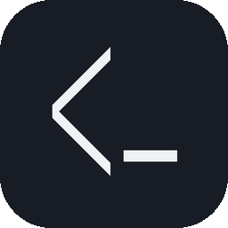
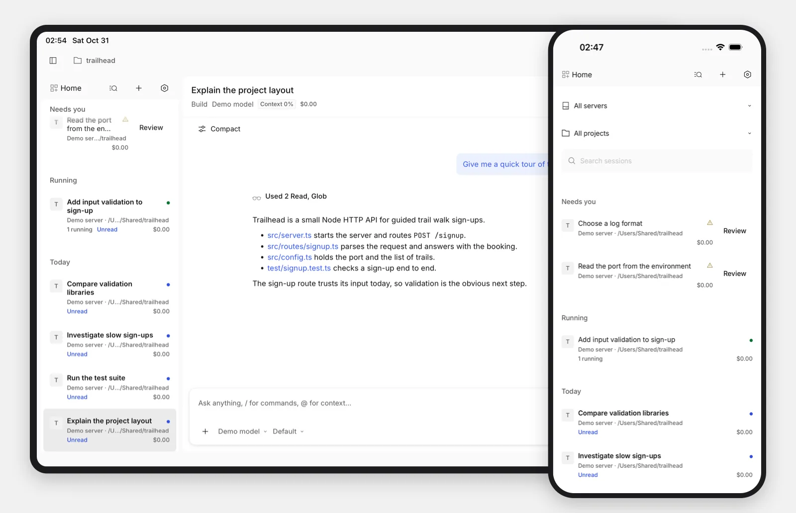
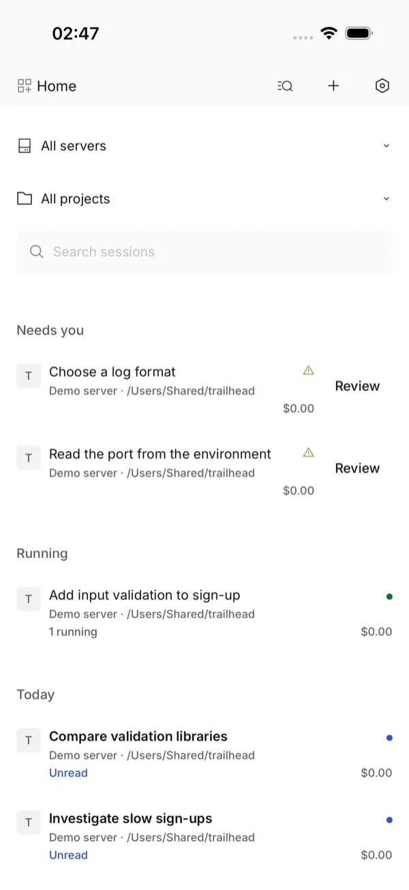
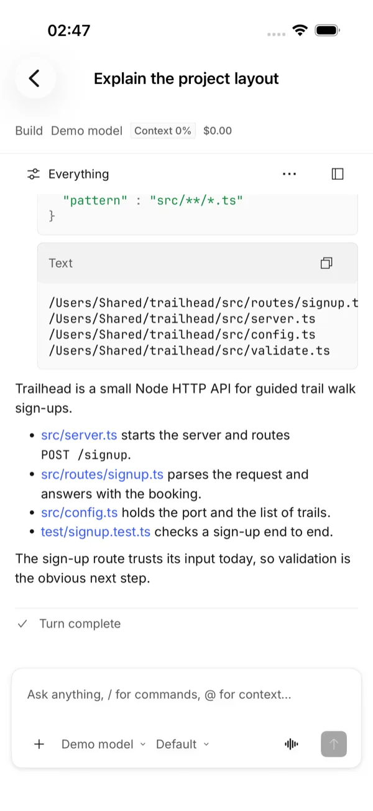
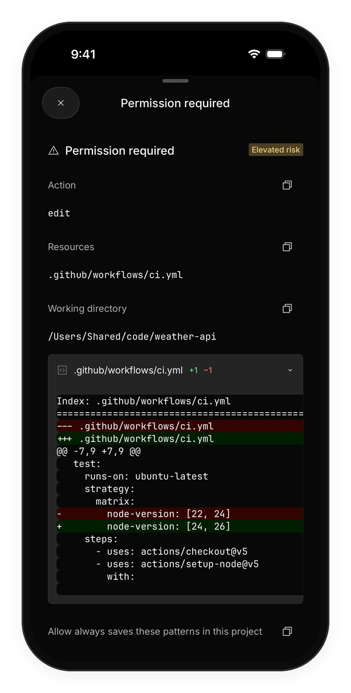
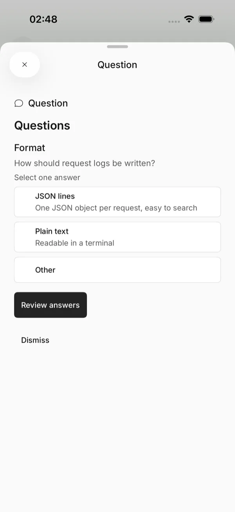
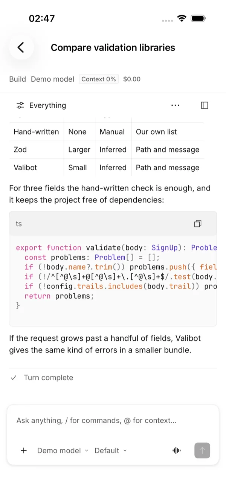
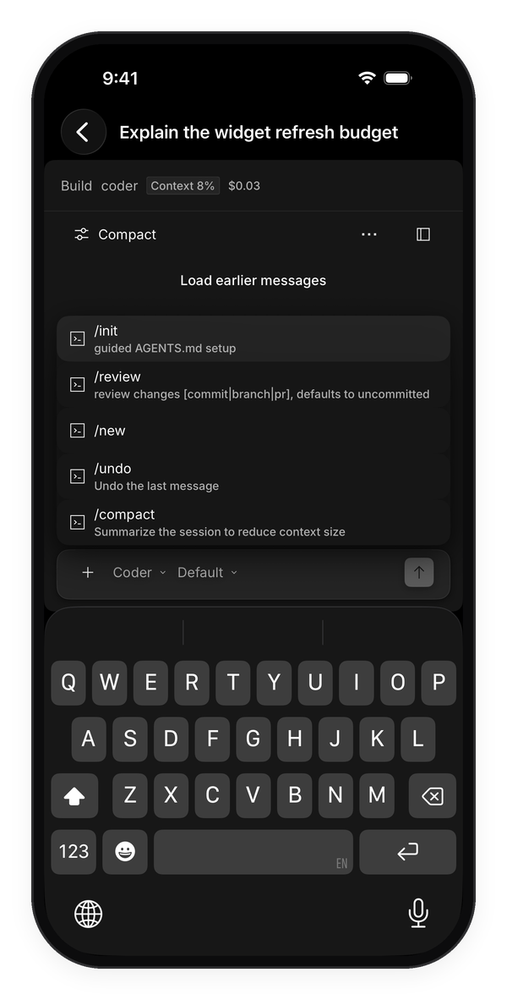
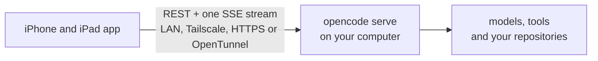
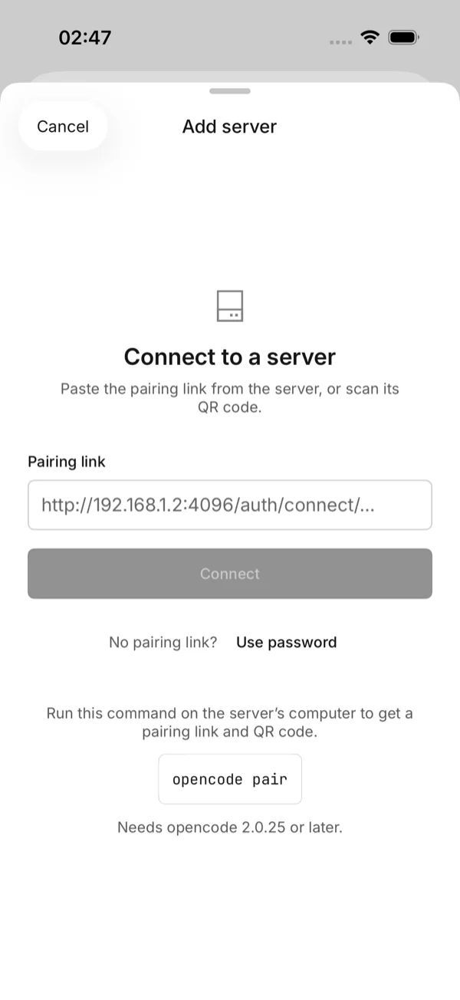

<div align="center">



# Opencode for iOS

A native iPhone and iPad client for your own [opencode](https://github.com/anomalyco/opencode) server.<br>
Follow every session live, answer approvals with the full diff in front of you, and steer the agent from anywhere.


[](LICENSE)
[](https://github.com/38st/opencode-ios/actions/workflows/ci.yml)



</div>

> [!NOTE]
> This is an unofficial client. It is not affiliated with or endorsed by the opencode project or Anomaly.

**Status:** in development, not yet on TestFlight or the App Store. Connection, Home, the live transcript, approvals, the composer, and review and files have landed (milestones M0 to M4). Push notifications (M5) come next. See the [roadmap](docs/roadmap.md).

## Features

- **Pairing.** Scan the QR code from `opencode pair`, paste its link, or enter a URL and password. Credentials stay in the Keychain, and a V1 server gets an upgrade screen instead of errors.
- **One Home for every server.** Sessions from all your servers and projects, grouped by day, with *Needs you* and *Running* on top, search, unread markers and pins.
- **A live transcript.** Streaming Markdown with highlighted code, reasoning, grouped tool calls, diff cards, live shell output and subagent drill-in. Long sessions load in pages.
- **Approvals with the full picture.** The whole command, path or diff is on screen before you answer. Allow once, Allow always (behind device authentication), or Reject with a note. Question forms cover every field type.
- **A real prompt dock.** `@` mentions for files, agents and skills, `/` commands, `!` shell mode, and image and PDF attachments. Pick the model, variant and agent. While a run is going, steer it, queue the next prompt or stop it.
- **Review and files.** Uncommitted, branch and last-turn changes as unified or split diffs with word-level highlights. Mark files reviewed, comment on selected lines for your next prompt, and browse the project's files with highlighting, find and previews.
- **Nothing gets lost.** Drafts and an outbox survive a kill and relaunch, and no prompt is sent twice.
- **Connections that recover.** Endpoint racing across LAN, Tailscale, HTTPS and OpenTunnel addresses, a stream watchdog, backoff, and a full resync after every reconnect.
- **An iPad workspace.** Project tabs, a collapsible Home sidebar and the session side by side, as in the desktop app.
- **The opencode look.** The desktop app's colours, fonts, icons and timeline, adapted for touch, Dynamic Type and dark mode.

## Screenshots

<table>
  <tr>
    <td align="center" valign="top" width="33%"><br><sub><b>Home.</b> Every server and project, with what needs you on top.</sub></td>
    <td align="center" valign="top" width="33%"><br><sub><b>Sessions.</b> Reasoning, grouped tool calls, context and cost.</sub></td>
    <td align="center" valign="top" width="33%"><br><sub><b>Approvals.</b> The full diff before you allow an edit.</sub></td>
  </tr>
  <tr>
    <td align="center" valign="top" width="33%"><br><sub><b>Questions.</b> The agent asks; you pick or write an answer.</sub></td>
    <td align="center" valign="top" width="33%"><br><sub><b>Markdown.</b> Tables and highlighted code, rendered natively.</sub></td>
    <td align="center" valign="top" width="33%"><br><sub><b>Prompt dock.</b> Slash commands, mentions and attachments.</sub></td>
  </tr>
</table>

<sub>These are screenshots of the real app in dark mode, connected to a sandboxed opencode 2.0.32 server. The projects are small demos and the repo's scripted model (`Tools/mock-llm`) drives the runs, but the tool calls, diffs and test output come from the server.</sub>

## How it works



The app is only a client. Your computer runs opencode, which runs the agents and stays the source of truth. The app reads and writes through opencode's V2 API, follows one event stream for live updates, and resyncs over REST after every reconnect. There is no account and no vendor server in between.

### Connect a server



You need opencode V2 2.0.10 or later; pairing links need 2.0.25 or later. On your computer:

```sh
opencode service set hostname 0.0.0.0   # let devices on your network reach the service
opencode pair                           # print a QR code and pairing links
opencode pair --remote                  # add an OpenTunnel address for use away from home
```

In the app, tap **Add your first server**, then scan the code or paste a link. You can also enter the server URL and the password from `opencode service get password`. Pairing tokens last 30 days; when one expires, the app asks you to pair again.

## Build from source

Requires Xcode 27.0 or later (Swift 6.4), XcodeGen 2.46.0 or later, and macOS 27 for the package tests. The app supports iOS and iPadOS 26.4 and later.

```sh
xcodegen generate
swift test --package-path Packages/OpencodeKit
xcodebuild -project Opencode.xcodeproj -scheme Opencode -destination 'platform=iOS Simulator,name=iPhone 17 Pro' -derivedDataPath .build/DerivedData build
xcrun simctl install booted .build/DerivedData/Build/Products/Debug-iphonesimulator/Opencode.app
xcrun simctl launch booted dev.opencodeios.client
```

`project.yml` is the source of truth; the generated Xcode project is not committed. Simulator builds need no signing team. For a device, set your team and bundle prefix in `Config/Signing.xcconfig`. Third-party packages are pinned to exact versions in `Packages/OpencodeKit/Package.swift`.

## Tests

| Command | What it covers |
| --- | --- |
| `swift test --package-path Packages/OpencodeKit` | Models, networking, sync, persistence and rendering against recorded server traffic in `Fixtures/`. No network. |
| `xcodebuild … -only-testing:ServerSnapshots` (and the other snapshot targets) | Screens and components in light and dark, at phone and iPad sizes and large text. |
| `node Tools/ui-smoke/index.mjs` | XCUITest flows on iPhone and iPad against a sandboxed opencode server and the scripted model. |
| `node Tools/contract/index.mjs` | Live contract checks against the newest opencode V2 release and the V1 detection server, including the push plugin. |
| `npm test` in `server/contracts`, `server/plugin` and `server/relay` | The push contracts and their vectors, the plugin against a fake opencode host, and the relay in the Workers runtime and on Node against a mock APNs. |
| `node Tools/push-e2e/index.mjs` | Push end to end on this Mac: the sandboxed server with the plugin, the relay in `wrangler dev`, a mock APNs, and the envelopes opened in Swift. |

CI builds and tests with both Xcode 27.0 and 27.1 on GitHub's arm64 [`xcode-27` preview runner](https://github.blog/changelog/2026-09-10-xcode-27-runner-image-now-runs-on-macos-27/), so code that only the newer compiler accepts is caught; the [runner inventory](https://github.com/actions/runner-images/blob/main/images/macos/xcode-27-arm64-Readme.md) lists both. A nightly workflow runs the live contract checks. [`Tools/README.md`](Tools/README.md) covers the sandbox, the scripted model, the fixture recorder and their isolation guarantees.

## Project layout

| Path | Contents |
| --- | --- |
| `App/` | The app target. It only wires things together. |
| `Packages/OpencodeKit/` | All logic, as Swift 6 modules: `OCModels` (tolerant wire models), `OCNetworking` (API client, SSE, pairing), `OCSecurity` (Keychain), `OCPersistence` (GRDB cache, drafts, outbox), `OCSync` (stores and resync), `OCPushCore` (push envelopes, digests and risk rules), `OCRender` (Markdown, highlighting, diffs), `OCDesign` (design system) and the `Feature*` screens. |
| `server/` | The push side, MIT-licensed: `contracts` (the payload, envelope, digest and risk rules shared with the app), `plugin` (the opencode plugin) and `relay` (the APNs relay for Cloudflare Workers, with a Node fallback). |
| `Fixtures/` | Recorded opencode traffic that the tests replay. |
| `Tools/` | The sandboxed server launcher, scripted model, fixture recorder, contract checks, push end-to-end, UI smoke harness and design reference capture. |
| `docs/`, `research/` | Design notes, milestone audits, the roadmap, the V2 protocol reference and the feature matrix. |

## Documentation

- [SPEC.md](SPEC.md): product goals, scope and open decisions.
- [ARCHITECTURE.md](ARCHITECTURE.md): modules, sync engine, persistence, push, security, testing and milestones.
- [docs/design.md](docs/design.md): how the opencode desktop design maps to native code.
- [docs/roadmap.md](docs/roadmap.md): milestone status and what is blocked on the owner.
- [research/01-opencode-server-api.md](research/01-opencode-server-api.md): the V2 protocol reference.
- [research/08-feature-matrix.md](research/08-feature-matrix.md): 141 features with their priorities.

## Contributing

Issues are welcome: bug reports, problems with a particular opencode version, and feature requests. Outside pull requests can't be merged until there is a contributor licence agreement, so please open an issue to discuss a change first. See [CONTRIBUTING.md](CONTRIBUTING.md). Report vulnerabilities privately through GitHub's private vulnerability reporting, as [SECURITY.md](SECURITY.md) describes.

## Licence

Copyright © 2026 38st.

The app is licensed under the [GNU General Public License v3.0 only](LICENSE) (GPL-3.0-only). The push plugin ([`server/plugin`](server/plugin/LICENSE)), the relay ([`server/relay`](server/relay/LICENSE)) and their shared contracts ([`server/contracts`](server/contracts/LICENSE)) are MIT-licensed, each with its own LICENSE file.

Third-party material keeps its own licence. The look follows the opencode desktop app: its design tokens and icons (MIT), Material Icon Theme file icons (MIT), and the Inter and JetBrains Mono fonts (SIL Open Font License 1.1). [THIRD_PARTY_NOTICES.md](THIRD_PARTY_NOTICES.md) lists these and the Swift packages with their licences.
