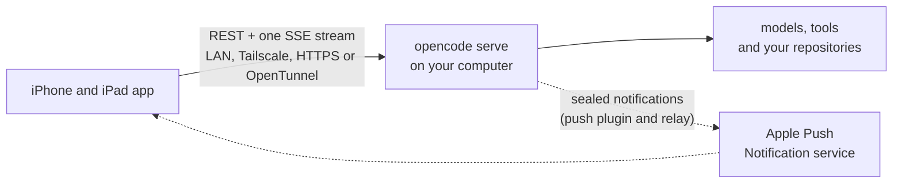

<div align="center">


# Opencode for iOS

A native iPhone and iPad client for your own [opencode](https://github.com/anomalyco/opencode) server.<br>
Follow every session live, answer approvals with the full diff in front of you, and steer the agent from anywhere.

[](../../actions/workflows/ci.yml)
[](../../actions/workflows/plugin.yml)
[](../../actions/workflows/relay.yml)
[](../../actions/workflows/contract.yml)<br>


[](LICENSE)


</div>

> [!NOTE]
> This is an unofficial client. It is not affiliated with or endorsed by the opencode project or Anomaly.

**Status:** version 1.0 is complete and in testing. It is not on TestFlight or the App Store yet; until it is, [build it from source](#build-from-source).

## Features

- **Pairing.** Scan the QR code from `opencode pair`, paste its link, or enter a URL and password. Credentials stay in the Keychain. An older server gets an upgrade screen instead of errors.
- **One Home for every server.** Sessions from all your servers and projects, grouped by day, with *Needs you* and *Running* on top, search, unread markers and pins.
- **A live transcript.** Streaming Markdown with highlighted code, tables, Mermaid diagrams and TeX, reasoning, grouped tool calls, diff cards, images, live shell output and subagent drill-in. Long sessions load in pages.
- **Approvals with the full picture.** The whole command, path or diff is on screen before you answer. Allow once, Allow always (behind device authentication), or Reject with a note. Question forms cover every field type.
- **Push notifications.** Sealed end to end, so only your device can read them. Approve or reject from the lock screen with risk tiers: Allow once needs an unlocked device, and high-risk requests offer only Open and Reject. A Live Activity follows a running session. Mute a session, set quiet hours, and choose which kinds you get; approvals are never silenced.
- **A real prompt dock.** `@` mentions for files, agents, skills and references, `/` commands, `!` shell mode, image and PDF attachments, prompt history and on-device dictation. Pick the model, variant and agent. While a run is going, steer it, queue the next prompt or stop it. `/btw` asks a side question without adding it to the session.
- **Review and files.** Uncommitted, branch and per-turn changes as unified or split diffs with word-level highlights. Mark files reviewed, comment on lines for your next prompt, ask the agent to commit and push or open a pull request, and browse the project's files with highlighting, find and previews.
- **A real terminal.** Terminals on your server with a key bar for Esc, sticky Ctrl and Alt, Tab and the arrows, hardware keyboards on iPad, and full-screen programs such as vim and less. A terminal picks up where it left off after the app was in the background or closed. Run a one-off command outside any session and watch or stop it.
- **Sessions and servers in your hands.** Rename, fork, compact, undo and redo, move a session to another worktree, and export a transcript as Markdown or redacted JSON. Usage statistics, providers and their sign-in, MCP servers, saved permissions, agents and commands, projects, configuration and worktrees are all in Settings.
- **Nothing gets lost.** Drafts and an outbox survive a kill and relaunch, and no prompt is sent twice.
- **Connections that recover.** Endpoint racing across LAN, Tailscale, HTTPS and OpenTunnel addresses, a stream watchdog, backoff, and a full resync after every reconnect.
- **An iPad workspace.** Project tabs, a collapsible Home sidebar and a review panel with Changes, Files, Terminal and Context beside the session, as in the desktop app. A menu bar with keyboard shortcuts, a ⌘K switcher across every server, a window for each session you want side by side, and drag and drop into the composer.
- **The rest of the system.** Shortcuts and Siri (send a prompt, check a session, open a session, review the next approval), Spotlight, Home and Lock Screen widgets, and Control Center controls.
- **The opencode look.** The desktop app's colours, fonts, icons and timeline, adapted for touch, Dynamic Type, VoiceOver and dark mode.

## Screenshots

<table>
  <tr>
    <td align="center" valign="top" width="33%"><br><sub><b>Home.</b> Every server and project, with what needs you on top.</sub></td>
    <td align="center" valign="top" width="33%"><br><sub><b>Sessions.</b> Reasoning, grouped tool calls, context and cost.</sub></td>
    <td align="center" valign="top" width="33%"><br><sub><b>Approvals.</b> The full diff before you allow an edit.</sub></td>
  </tr>
  <tr>
    <td align="center" valign="top" width="33%"><br><sub><b>Questions.</b> The agent asks; you pick or write an answer.</sub></td>
    <td align="center" valign="top" width="33%"><br><sub><b>Markdown.</b> Tables and highlighted code, rendered natively.</sub></td>
    <td align="center" valign="top" width="33%"><br><sub><b>Prompt dock.</b> Slash commands, mentions and attachments.</sub></td>
  </tr>
</table>

<sub>These are screenshots of the real app in dark mode, connected to a sandboxed opencode 2.0.32 server. The projects are small demos and the repository's scripted model (`Tools/mock-llm`) drives the runs, but the tool calls, diffs and test output come from the server.</sub>

## How it works



The app is only a client. Your computer runs opencode, which runs the agents and stays the source of truth. The app reads and writes through opencode's V2 API, follows one event stream for live updates, and resyncs over REST after every reconnect. There is no account and no vendor server in the conversation between the app and your server.

## Requirements

- An iPhone or iPad on iOS or iPadOS 26.4 or later.
- An opencode V2 server, version 2.0.25 or later, that the device can reach: on the same network, over Tailscale, behind your own HTTPS, or through opencode's OpenTunnel relay. An opencode 1.x server gets a screen that explains how to upgrade.
- For notifications, the push plugin on that server (see [Notifications](#notifications)).

## Connect a server


On your computer:

```sh
opencode service set hostname 0.0.0.0   # let devices on your network reach the service
opencode pair                           # print a QR code and pairing links
opencode pair --remote                  # add an OpenTunnel address for use away from home
```

In the app, tap **Add your first server**, then scan the code or paste a link. You can also enter the server URL and the password from `opencode service get password`. Pairing tokens last 30 days; when one expires, the app asks you to pair again.

Add as many servers as you like. Each one can have several addresses, such as a LAN address and an OpenTunnel address, and the app uses whichever answers first.

<br clear="right">

## Notifications

opencode itself has no push notifications, so they come from a small server plugin in this repository ([`server/plugin`](server/plugin)). The plugin watches your sessions and, when one needs you or finishes, seals a notification for each of your devices with HPKE. Only the device holds the key to open it. Approving from a notification never goes through anything but the app's own connection to your server, and the app re-reads the request and checks that it still matches what you saw before it answers.

Install the plugin once on each server, as [`server/plugin/README.md`](server/plugin/README.md) describes, then open **Settings → Notifications** in the app and tap **Enable notifications**. The app detects the plugin on each server and shows the install command where it is missing.

**Through the relay.** Sealed notifications reach Apple through a relay ([`server/relay`](server/relay)) that holds the app's APNs key. The relay sees device tokens, timing, the kind of notification, the padded size and the IP addresses of your server and phone, but never the content, and it is not on the path of any approval. If you build the app yourself, you can run your own relay; its README covers deploying it.

## Privacy

- **No account and no telemetry.** The app has no analytics, crash-reporting or advertising SDKs, and it talks only to your servers, plus the push relay and Apple's push service if you turn on notifications.
- **Credentials stay on the device.** Server passwords and pairing tokens live in the device's Keychain. They don't sync through iCloud and don't move to a new device.
- **History is cached on the device** for fast launches and offline reading: up to the 200 most recent sessions or 300 MB, protected by iOS data protection.
- **Notifications are sealed.** See [Notifications](#notifications). A Live Activity's status (its phase, step count, current tool kind and two timestamps) is visible to the relay and to Apple, so it carries nothing else.
- **Exports are redacted by default.** Titles, paths, prompts, replies and tool output become placeholders unless you turn that off.

The security design is in [ARCHITECTURE.md](ARCHITECTURE.md) (sections 4 and 5), and [SECURITY.md](SECURITY.md) explains how to report a vulnerability.

## Build from source

Requires Xcode 27.0 or later (Swift 6.4), [XcodeGen](https://github.com/yonaskolb/XcodeGen) 2.46.0 or later, macOS 27 for the package tests, and Node 26 for the server packages and test tools.

```sh
xcodegen generate
swift test --package-path Packages/OpencodeKit
xcodebuild -project Opencode.xcodeproj -scheme Opencode -destination 'platform=iOS Simulator,name=iPhone 17 Pro' -derivedDataPath .build/DerivedData -skipPackagePluginValidation build
xcrun simctl install booted .build/DerivedData/Build/Products/Debug-iphonesimulator/Opencode.app
xcrun simctl launch booted dev.opencodeios.client
```

`project.yml` is the source of truth; the generated Xcode project is not committed. Simulator builds need no signing team. For a device, set your team and bundle ID prefix in `Config/Signing.xcconfig`. Third-party packages are pinned to exact versions in `Packages/OpencodeKit/Package.swift`. SwiftTerm applies a build plugin that records its version; `-skipPackagePluginValidation` lets `xcodebuild` run it without trusting it in Xcode first.

## Tests

| Command | What it covers |
| --- | --- |
| `swift test --package-path Packages/OpencodeKit` | Models, networking, sync, persistence and rendering against recorded server traffic in `Fixtures/`. No network. |
| `xcodebuild … -only-testing:ServerSnapshots` (and the other snapshot targets) | Screens and components in light and dark, at phone and iPad sizes and large text. |
| `node Tools/ui-smoke/index.mjs` | XCUITest flows on iPhone and iPad against a sandboxed opencode server and the scripted model. |
| `node Tools/contract/index.mjs` | Live contract checks against the newest opencode V2 release and the V1 detection server, including the push plugin. |
| `npm test` in `server/contracts`, `server/plugin` and `server/relay` | The push contracts and their vectors, the plugin against a fake opencode host, and the relay in the Workers runtime and on Node against a mock APNs. |
| `node Tools/push-e2e/index.mjs` | Push end to end on one Mac: the sandboxed server with the plugin, the relay in `wrangler dev`, a mock APNs, and the envelopes opened in Swift. |

CI builds and tests the app with Xcode 27.0 and 27.1 on GitHub's arm64 [`xcode-27` runner image](https://github.com/actions/runner-images/blob/main/images/macos/xcode-27-arm64-Readme.md), so code that only the newer compiler accepts is caught, and tests the plugin and relay on every change to them. A nightly workflow runs the live contract checks against the newest opencode release. [`Tools/README.md`](Tools/README.md) covers the sandbox, the scripted model, the fixture recorder and their isolation guarantees.

## Project layout

| Path | Contents |
| --- | --- |
| `App/`, `Extensions/` | The app target, which only wires things together, and its notification service and widget extensions. |
| `Packages/OpencodeKit/` | All logic, as Swift 6 modules: `OCModels` (tolerant wire models), `OCNetworking` (API client, SSE, pairing), `OCSecurity` (Keychain), `OCPersistence` (GRDB cache, drafts, outbox), `OCSync` (stores and resync), `OCPushCore` (push envelopes, digests and risk rules), `OCRender` (Markdown, highlighting, diffs), `OCDesign` (design system), `OCIntents` and `OCActivity` (system integration) and the `Feature*` screens. |
| `server/` | The push side, MIT-licensed: `contracts` (the payload, envelope, digest and risk rules shared with the app), `plugin` (the opencode plugin) and `relay` (the APNs relay for Cloudflare Workers, with a Node entry point). |
| `Fixtures/` | Recorded opencode traffic that the tests replay. |
| `Tools/` | The sandboxed server launcher, scripted model, fixture recorder, contract checks, push end to end, UI smoke harness and design reference capture. |
| `docs/`, `research/` | Design notes and the opencode V2 protocol reference. |

## Documentation

- [ARCHITECTURE.md](ARCHITECTURE.md): modules, sync engine, persistence, push, security and testing.
- [docs/design.md](docs/design.md): how the opencode desktop design maps to native code.
- [research/01-opencode-server-api.md](research/01-opencode-server-api.md): the opencode V2 protocol reference.
- [server/plugin](server/plugin/README.md), [server/relay](server/relay/README.md) and [server/contracts](server/contracts/README.md): the push side in detail.
- [CHANGELOG.md](CHANGELOG.md): what changed in each release.

## Contributing

Issues are welcome: bug reports, problems with a particular opencode version, and feature requests. Outside pull requests can't be merged until there is a contributor licence agreement, so please open an issue to discuss a change first. See [CONTRIBUTING.md](CONTRIBUTING.md) and the [code of conduct](CODE_OF_CONDUCT.md). Report vulnerabilities privately, as [SECURITY.md](SECURITY.md) describes.

## Licence

Copyright © 2026 38st.

The app is licensed under the [GNU General Public License v3.0 only](LICENSE) (GPL-3.0-only). The push plugin ([`server/plugin`](server/plugin/LICENSE)), the relay ([`server/relay`](server/relay/LICENSE)) and their shared contracts ([`server/contracts`](server/contracts/LICENSE)) are MIT-licensed, each with its own LICENSE file.

Third-party material keeps its own licence. The look follows the opencode desktop app: its design tokens and icons (MIT), Material Icon Theme file icons (MIT), and the Inter and JetBrains Mono fonts (SIL Open Font License 1.1). [THIRD_PARTY_NOTICES.md](THIRD_PARTY_NOTICES.md) lists these and every Swift and npm package with its licence.
